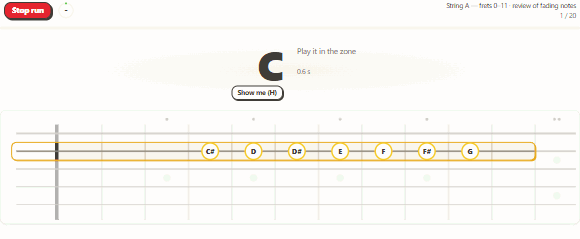
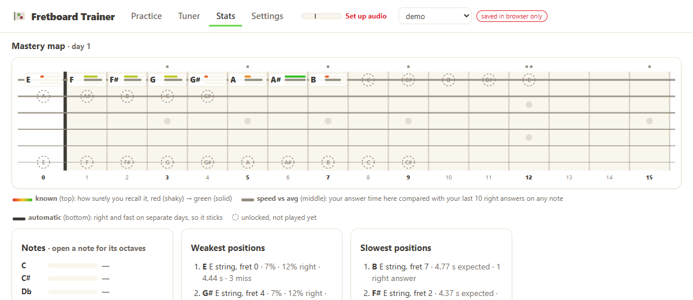

# Fretboard Trainer

Learn the guitar fretboard by playing. The app listens to your guitar (DI through an audio interface, or a mic), asks for notes inside a zone of the neck, and uses spaced repetition to focus on what you find hard: the note, its exact position, the shape of the zone, and how fast you answered.

## What a run looks like

A run asks for about 20 notes inside one zone of the neck. Play each one (no guitar at hand: click it on the board). A right note turns green; a wrong one shows where the note was, and comes back a few prompts later. The bar on top has a step per answer: green when right, red when wrong.

## Why spaced repetition

A new fact fades within hours unless you recall it again. Each time you pull it from memory just before it fades, it lasts longer: minutes, then days, then weeks. The app keeps a memory model of every position on the neck (how surely you recall it, and how fast) and brings each one back when it is about to slip. So a short run every day sticks far better than a long session once a week: notes you miss come back often, notes you know fade out of the rotation.

## How it gets harder

You start near the nut on the low strings. Zones next to what you know open as you master them, and the app picks zones you should get about 4 in 5 right: never too easy, never too hard. Below, the mastery map over a learner's first 24 days (mock data, two short runs a day): each position starts shaky (red) and slow, then turns green, quicker and more automatic with practice, while new positions open around it. Dashed circles: unlocked, not played yet; the three bars: how surely you recall the note, your speed there against your average, and how automatic it is.

## Run it

The app is at <https://fauconnier-n.github.io/fretboard_learn/> (Chrome or Edge recommended; it installs as an app). It always runs the [latest release](https://github.com/fauconnier-n/fretboard_learn/releases/latest), whose number is in the badge above and in the app under Settings → Data. On the first start it asks for a name and where to keep your data: a folder you pick (one inside OneDrive or Dropbox follows you to another computer), or just the browser. See [Profiles and storage](#profiles-and-storage).

To run it on your own computer instead, double-click `start.bat`. It starts a tiny PowerShell server on <http://localhost:8137> and opens your browser (Chrome or Edge recommended). If the server is already running, it just opens the browser. Keep the server window open while you practise: it also saves the disk copy of your data (see below). Then:

1. **Settings → Audio input** (the most important step: the first start takes you there): pick your interface and the input channel your guitar is plugged into. Adjust the gain so the meter moves when you play.
2. **Tuner**: tune up and check the notes read cleanly.
3. **Practice → Start run**.

Every release lists its changes on the [releases page](https://github.com/fauconnier-n/fretboard_learn/releases).

## Profiles and storage

A **profile** is a name and a place where its data is copied. The first start offers to open an existing profile folder (from another computer, say) or to make a profile: a name, then *a folder I choose* (the app makes `fretboard-<name>` inside the location you pick), *the `data` folder next to the app* (when the app runs from `start.bat`) or *just this browser*; then the instrument and tuning page, which can be changed any time. With two or more profiles the app asks who is practising when it opens; the header switch changes profile meanwhile, and *+ New profile…* adds one. Each profile has its own data; `test` is meant for trying things out.

Data lives in the browser's **IndexedDB** (`js/idb.js`), per profile, in three stores:
- `kv` holds the settings and, per set of strings, what the model keeps between starts: its version and `meta` (difficulty target, run history, best runs, fitted decay). The knowledge itself (cards, note stats, contexts, confusions) is replayed from `attempts` at every start and saved only at the end of a run, so answering costs one row, not a 100 KB rewrite.
- `attempts` holds one row per prompt: the first answer and its time, the time to the right note, each wrong note and when it was played, and the prompt asked just before.
- `runs` holds one row per run: zone, mode (prompts or sprint) and its length, settings in use, and how it ended (`completed`, `time_up`, `stopped`, `left` for another tab or a board change, `closed` if the page was closed mid-run). `attempts.run_id` links the two.

**Settings → Database tables** shows the newest rows of both log tables and what each column means (hover a column header too). The column documentation lives in `TABLES` in `js/storage.js`; rows are stored by those column names on disk and in the JSON export.

The whole profile is also kept in memory while the app runs: the model is replayed from every answer at each start anyway, and the stats are plain filters over a few thousand rows (`js/logQueries.js`). A write counts once IndexedDB has it (written with strict durability). Until 1.1 the data lived in DuckDB-WASM (a 34 MB module, an OPFS file that lost data twice in testing) with this IndexedDB store as its safety copy; the store is unchanged, so the data written then is read as it is, and the old `fretboard-<name>.duckdb` files are left where they are, unused.

**Disk copy.** All of the above lives in the browser, so "clear site data", another browser, another Chrome profile or another address (`127.0.0.1`, another port) would lose or hide all of it at once. So every write also goes to the profile's folder (`js/disk.js`, layout in `js/disklayout.js`): a folder you picked, written by the browser itself (File System Access API: Chrome and Edge on a computer; `js/diskFolder.js`), or `data\<name>\` next to the app, written by the local server (the `/api/` part of `serve.ps1`). Both hold the same files:
- `profile.json`: the profile's name.
- `attempts/<time>-<run id>.jsonl`: the answers of one run, one per line, only ever appended to. One small file per run, so a synced folder uploads little after each answer and two computers never write the same file.
- `runs/<time>-<run id>.jsonl`: that run's row, written when it starts and when it ends (the last line wins).
- `kv.json`: settings and the models' meta, replaced whole (the server keeps the previous version as `kv.json.bak`). The settings carry the time they were saved: between two computers the newer copy wins. The audio setup (input device, channel, gain, noise gate, pitch clarity, latency, strum level) belongs to the computer: it stays in that browser and is never written here.
- `attempts.jsonl` and `runs.jsonl` from earlier versions are still read, never written.

When the app starts, it compares the browser with the folder and copies whatever is missing in either direction, matching answers by time and position and runs by id. Answers that come back from the folder make the app rebuild the model from the log, and a banner says how many came back. Without a reachable copy the badge shows *saved in browser only* (or *folder: reconnect* when the browser wants your permission again: the app remembers the folder, Chrome remembers the permission once the app is installed or you choose "Allow on every visit"); with the server down, the writes waiting are sent when it is back (checked every 30 s). A reset or a JSON import replaces the copy too, and refuses while the copy cannot be reached (otherwise the next sync would bring the old answers back); it makes a backup first. The local server only accepts API requests from the app's own address. The files are plain JSON lines: back up the folder like any other, or query it with the DuckDB command-line tool, for example `select * from read_json('data/user/attempts/*.jsonl')`.

Answers are only ever added in this sync, never deleted. If you reset a profile in one browser while another browser still has its answers, the other browser puts them back on its next start.

**Settings → Data** manages the folder (*Create a folder…* or *Move to a new folder…* makes a fresh `fretboard-<name>` folder where you choose and copies everything there, leaving the old one as it is; *Use an existing folder…* points the profile at one; *Disconnect*), and other profiles' data: **Bring / sync** adds another profile's answers and runs to this one (from its data in this browser, its folder, or any folder you pick), tagged with the `origin` column, and only what is new on a second pass; each origin can be removed again. Settings and models are not copied: the model is rebuilt from the whole log.

The app also warns when it is opened at a local address other than <http://localhost:8137>, because the browser keeps a separate, empty storage for each address.

- To read the active profile's rows from the browser console, run `ft.rows('attempts')` or `ft.rows('runs')` (by column name, oldest first), e.g. `console.table(ft.rows('runs').slice(-10))`. For SQL, query the profile folder's JSON lines with the DuckDB command-line tool (above).
- **Settings → Data → Export JSON** makes a backup of the current profile. A profile folder inside OneDrive or Dropbox is the easier way to another computer: open it there with *Open my folder…*.
- Keep the app open in only one tab at a time. Each tab holds the profile in memory, so only the first one may write it; if two tabs are open, the badge in the second shows *NOT SAVED*.

## How it works

- **Zones**: 12 cells holding each of the 12 notes exactly once. These are either boxes or 12 frets on one string. A box takes 2 to 6 adjacent strings, at least 2 frets on each: over 3 to 6 strings it spans at most 6 frets; over 2 strings it needs 7 (one fret further on the higher string, 8 across G–B), so only those stretch. More strings make a box a little harder, so wide ones come later. Answers must be the exact pitch, so there is only one right spot.
- **Instruments**: 6- to 9-string guitars and 4- to 6-string basses; standard or drop tuning shifted by semitones, or a custom tuning. Progress follows each string by its open note, so switching instruments keeps what the strings have in common (`js/instruments.js`).
- **Runs**: a number of prompts or a sprint; on the guitar (play the note, mix-ups) or without it (name the note, true or false); optional beat mode whose tempo follows your answers. Pick one of up to three offered zones. The whole flow can be driven from the guitar: two muted strums take the menu's green option (new run, start, resume), three stop a run, and choices sit on the open strings. Prompts focus on weaker cells and can repeat; a prompts run ends with its hardest note, then a note you know. The board shows your progress live, with fog over locked positions.
- **Two signals per note and position**, kept apart (see `js/srs.js`):
  - *memory*, from right/wrong only (a wrong answer or a timeout is a miss): stability, difficulty and accuracy;
  - *speed*, from the time of each right first answer: a running average of log answer time, with no buckets. While a position has few answers, its estimate leans on the same note name, then on your overall typical time.

  Prompts favour positions you are forgetting and positions that are right but slow, or slower than your usual. The answer log keeps every time, including time to the right note and each wrong note, so *Rebuild model from log* can replay it.
- **Note names on the board**: by default, a name label shows on the zone positions you don't know well yet and is dropped as you answer them right (Settings → Practice). Check-ups never show labels. Each answer logs the labels shown and their distance to the note asked.
- **Memory model**: each position (string + fret) is an FSRS-style card. There are also per-note stats and a per-position history tagged by zone *shape* (centroid, strings, span, where the cell sits in the shape), so weaknesses carry over to similar zones.
- **Intervals tab**: a marked root and a question to play: octave shapes first, then intervals, triads and scale degrees, each opening once the earlier ones are known (`js/intervals.js`).
- **Chord page** (under Practice): chord grips up to the sevenths in open, power, barre, shell and triad voicings, opening group by group. Play the chord (strings one by one, any order), Name the chord, or Changes (short progressions, with beat mode). Each grip has its own memory card, and the degree labels on the board fade as you learn it (`js/chords.js`).
- **Curriculum**: zones are picked to match a target predicted success, by default 80%, which adapts to your results. It starts on low E / low frets and unlocks material next to what you already know. With 8 or more items due, the run is a review and no new material is offered until the backlog is down.

## Development

The app needs no build. Node is only used for dev checks (`npm install` once):
- `npm test`: tests for the logic that runs without a page (notes and tunings, zones, the scheduler and its model check, intervals, chords, pitch and strum detection, the disk layout, stats and progress), with Node's built-in runner (`tests/`).
- `npm run lint`: ESLint.
- `npm run typecheck`: type-checks the modules that start with `// @ts-check`.
- `node tools/browser-check.mjs tools/tour.mjs --out <folder>`: opens the app in headless Edge as profile `test`, walks through the main screens and saves a screenshot of each (the server must be running). `tools/profiles.mjs` (with `--fresh --no-seed`) walks the welcome screen, the picker and the Data page; `tools/hosted.mjs` does the same against `node tools/static.mjs`, a plain static server, with `--host fretboard.test --secure` so the app behaves as on GitHub Pages. `tools/welcome.mjs` walks a beginner's first start; `tools/boxes.mjs` finds a 2-string and a 5–6-string box in the Ready menu. The README's GIFs: `node tools/seed-growth.mjs screenshots/growth-data` (mock data of a learner's first days), `tools/readme.mjs` (`--fresh --no-seed`) shows the mastery map at each and records a run, then `node tools/readme-gifs.mjs <folder>` writes `media/`.
- The same checks run on GitHub for pull requests and pushes to `main` and before each release is deployed (`.github/workflows/pages.yml`); nothing runs on `dev`.
- `npm run perf` (`node tools/perf.mjs [--out file.json] [--compare baseline.json] [--seed k]`): measures the app headless as user `test`: cold and warm start (the `app:*` and `db:*` marks of `js/main.js` and `js/storage.js`, visible in the console with `performance.getEntriesByType('mark')`), a run of answers and what it writes, layouts and paints per second during a run, the Stats tab, the end-of-run backup. `--seed k` multiplies the test user's answer log k times first. `tools/cdp.mjs` holds the headless-browser plumbing shared by both tools.

## Hosting

The site at <https://fauconnier-n.github.io/fretboard_learn/> is GitHub Pages. Publishing a [release](https://github.com/fauconnier-n/fretboard_learn/releases) (`vX.Y.Z`, semantic versions) runs the checks and deploys that tag, with the version written into `js/version.js`; pushes and pull requests to `main` only run the checks (`.github/workflows/pages.yml`). So the current release is always what the site runs. Work happens on the `dev` branch; `main` only moves at a release. It is a static site with no build step, so any HTTPS static host would do; the microphone needs HTTPS or localhost. It's an installable PWA. For app stores, wrap it with Capacitor. A static host has no `/api/`, so there the disk copy is the folder the user picks (Chrome and Edge on a computer) or nothing (the badge says *saved in browser only*).
